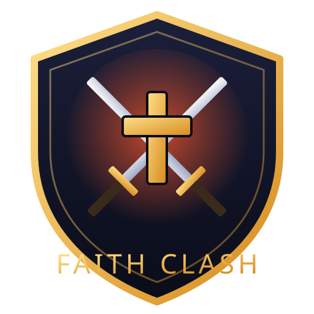
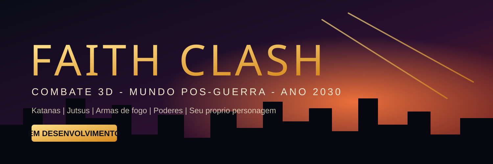

<p align="center">
  
</p>

<h1 align="center">Faith Clash</h1>

<p align="center">
  Jogo de combate 3D em terceira pessoa num mundo pos-guerra mundial (2026-2030).<br>
  Katanas, jutsus, estilos de luta, armas de fogo e poderes - com personagem criado pelo jogador.
</p>



> **Status:** em desenvolvimento inicial. Modo Treino jogavel (prototipo com primitivas).

## Sobre

Faith Clash e um jogo de combate para **PC (offline)**, feito na **Unity 6 (6000.6.6f1)** com URP. No futuro tera **online (1v1 e modo livre PvP)** e versao **mobile**.

Inspiracoes: Jujutsu Kaisen, Naruto, Dragon Ball Z, Naraka: Bladepoint, Elden Ring e MMORPGs de aventura.

## Modos de jogo

| Modo | Descricao | Estado |
|---|---|---|
| Treino | Praticar combos, esquiva e defesa contra bonecos, com dano total e DPS | Prototipo |
| Historia | Campanha com personagem proprio | Planejado |
| Arcade | Lutas sequenciais com pontuacao | Planejado |
| Livre | Mundo aberto, PvP no futuro | Planejado |
| Online | Batalhas 1v1 e PvP livre | Futuro |

## Controles (Modo Treino)

| Acao | Teclado / Mouse | Controle |
|---|---|---|
| Mover | WASD | Analogico esquerdo |
| Camera | Mouse | Analogico direito |
| Correr | Shift | Clique analogico esquerdo |
| Pular | Espaco | A / Cruz |
| Esquiva | Ctrl | B / Bolinha |
| Golpe leve (combo x3) | Botao esquerdo | X / Quadrado |
| Golpe pesado | Botao direito | Y / Triangulo |
| Defender | Q | LT / L2 |
| Zerar stats / Reiniciar | T / R | - |
| Soltar mouse | Esc | - |

## Como rodar

1. Instale a **Unity Hub** e o editor **6000.6.6f1**.
2. Clone o repositorio e abra a pasta pelo Unity Hub.
3. Menu **Faith Clash > Criar Cena de Treino** (cria `Assets/_FaithClash/Scenes/Training.unity`).
4. Aperte **Play**.

## Estrutura

```
Assets/_FaithClash/
  Scripts/{Core,Player,Combat,Training,Editor}
  Scenes  Materials  Prefabs  Art  Audio  Animations
Branding/   logo e banner
Docs/       GDD e roadmap
```

## Roadmap

Veja [Docs/GDD.md](Docs/GDD.md).

## Licenca

Todos os direitos reservados ate definicao de licenca. Jogo original; nenhum asset de franquias de terceiros deve ser incluido no repositorio.
